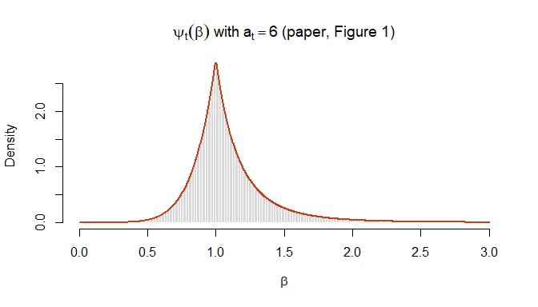
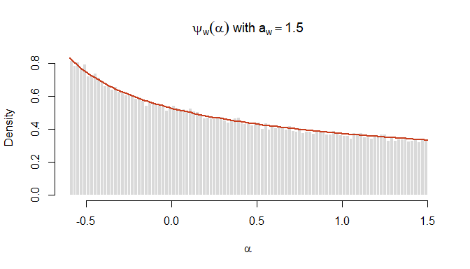
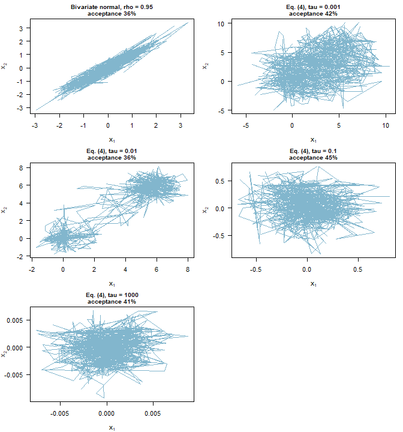
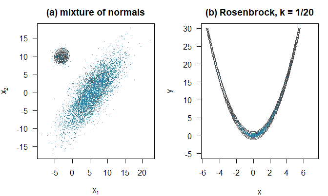
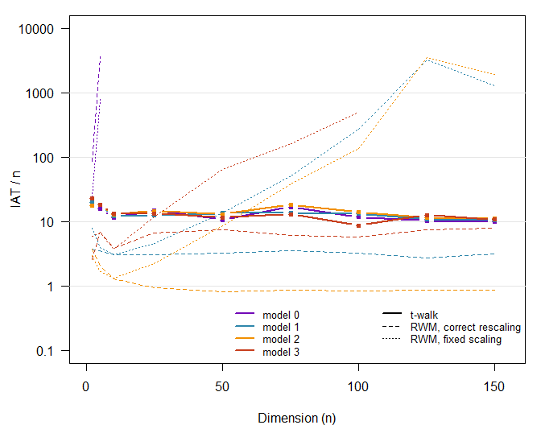

> This vignette is precomputed: its code is run when the package is
> developed, not when it is installed, because some experiments take a few
> minutes. The full source is in `vignettes/reproducing_christen_fox.Rmd.orig`.

This document checks the implementation in **Rtwalk** against the article
that introduced the t-walk:

> Christen, J. A. and Fox, C. (2010). A general purpose sampling algorithm for
> continuous distributions (the t-walk). *Bayesian Analysis*, 5(2), 263--282.
> <doi:10.1214/10-BA603>

It is organized by the sections of the paper. Each section first states what
the paper specifies and then verifies it numerically. The last section
discusses the one point where our numbers differ from the article: some of
the reported acceptance rates.


``` r
library(Rtwalk)
set.seed(2010)
```

## 1. Where each piece of the paper lives in the code

The t-walk maintains two points, $x$ and $x'$, and is a Metropolis--Hastings
sampler on the product space with target $f(x, x') = \pi(x)\pi(x')$. At each
step only one of the points moves: the proposal is $(x, h(x', x))$ or
$(h(x, x'), x')$, each with probability 1/2 (equation 1 of the paper). The
function $h$ is one of four moves.

| Paper | Content | Rtwalk |
|:------|:--------|:-------|
| Sec. 2, eq. (1) | update one of the two points | `twalk_move()` |
| Sec. 2 | random subset of coordinates, $np = \min(n, n_1)$ | `p_phi = min(n, n1) / n` |
| Sec. 2.1 | Walk move $h_w$ and $\psi_w$ | `kernel_walk()` |
| Sec. 2.2, eq. (2) | Traverse move $h_t$, $\psi_t$, Jacobian $\beta^{n_I - 2}$ | `kernel_traverse()`, `simulate_beta()` |
| Sec. 2.3 | Hop move $h_h$ and $g_h$ | `kernel_hop()`, `log_density_hop()` |
| Sec. 2.3 | Blow move $h_b$ and $g_b$ | `kernel_blow()`, `log_density_blow()` |
| Sec. 2.5 | $w = (0.4918, 0.4918, 0.0082, 0.0082)$, $n_1 = 4$, $a_w = 1.5$, $a_t = 6$ | `twalk_control()` defaults |

These R functions form a **reference implementation** that follows the
paper literally. Sampling is done by a compiled C++ translation of it, and
the test suite checks that both produce the same chains draw by draw. The
defaults of `twalk_control()` are those of Section 2.5:


``` r
twalk_control()
#> t-walk control parameters
#>   n1 = 4, aw = 1.5, at = 6
#>   kernel probabilities: traverse = 0.4918, walk = 0.4918, blow = 0.0082, hop = 0.0082 
#>   store companion: TRUE 
#>   engine: cpp
```

## 2. The proposal distributions

### The Traverse move (Section 2.2, Figure 1)

The step $\beta$ of the Traverse move has density

$$\psi_t(\beta) = \frac{a_t - 1}{2a_t}(a_t + 1)\beta^{a_t}\,I_{(0,1]}(\beta) +
\frac{a_t + 1}{2a_t}(a_t - 1)\beta^{-a_t}\,I_{(1,\infty)}(\beta),$$

which satisfies $\psi_t(1/\beta) = \psi_t(\beta)$, and is simulated with
equation (2). The paper sets $a_t = 6$, "giving $P(\beta < 2) \approx 0.98$".


``` r
psi_t <- function(beta, at = 6) {
  ifelse(beta <= 1,
         (at - 1) / (2 * at) * (at + 1) * beta^at,
         (at + 1) / (2 * at) * (at - 1) * beta^(-at))
}

betas <- replicate(1e5, Rtwalk:::simulate_beta(6))
hist(betas[betas < 3], breaks = 120, freq = FALSE, col = "grey85", border = "white",
     main = expression(psi[t](beta) ~ "with" ~ a[t] == 6 ~ "(paper, Figure 1)"),
     xlab = expression(beta), xlim = c(0, 3))
curve(psi_t(x), from = 0.001, to = 3, n = 1000, add = TRUE, lwd = 2, col = "#C73E1D")
```

<div class="figure">

<p class="caption">Draws of the Traverse step (histogram) and the density psi_t (red), as in Figure 1 of the paper.</p>
</div>

``` r
mean(betas < 2)
#> [1] 0.98285
1 - (6 + 1) / (2 * 6) * 2^(1 - 6)   # exact P(beta < 2)
#> [1] 0.9817708
```

### The Walk move (Section 2.1)

The Walk move uses $\alpha_j$ with density
$\psi_w(\alpha) \propto 1/\sqrt{1 + \alpha}$ on $[-a_w/(1 + a_w), a_w]$,
simulated by inversion as $\alpha = \frac{a_w}{1 + a_w}(-1 + 2u + a_w u^2)$.
This choice makes the proposal symmetric, so the acceptance probability is
the ratio of target densities.


``` r
aw <- 1.5
u <- runif(1e5)
alpha <- aw / (1 + aw) * (-1 + 2 * u + aw * u^2)
k <- 1 / (2 * (sqrt(1 + aw) - 1 / sqrt(1 + aw)))
hist(alpha, breaks = 100, freq = FALSE, col = "grey85", border = "white",
     main = expression(psi[w](alpha) ~ "with" ~ a[w] == 1.5), xlab = expression(alpha))
curve(k / sqrt(1 + x), from = -aw / (1 + aw), to = aw, add = TRUE, lwd = 2, col = "#C73E1D")
```

<div class="figure">

<p class="caption">Draws of the Walk-move variable (histogram) and the density psi_w (red).</p>
</div>

### The Hop and Blow moves (Section 2.3)

For the Hop move, $h_h(x, x')_j = x_j + \sigma z_j / 3$ with
$\sigma = \max_{I_j = 1} |x_j - x'_j|$; for the Blow move,
$h_b(x, x')_j = x'_j + \sigma z_j$. The paper gives their densities in
closed form; the package's helpers return $-\log g$, which we compare with
the formulas of the paper on an example where only some coordinates move:


``` r
x <- c(0.3, -1, 2, 5); xp <- c(1, 0.5, -2, 4)
phi <- c(TRUE, FALSE, TRUE, TRUE); n_I <- sum(phi)
sigma <- max(abs(x - xp)[phi])

y <- x; y[phi] <- x[phi] + c(0.2, -0.4, 0.1)            # a Hop proposal
g_h <- (2 * pi)^(-n_I / 2) * 3^n_I / sigma^n_I *
  exp(-9 / (2 * sigma^2) * sum((y - x)[phi]^2))
c(paper = -log(g_h), Rtwalk = Rtwalk:::log_density_hop(n_I, phi, y, x, xp))
#>    paper   Rtwalk 
#> 3.678924 3.678924

y <- x; y[phi] <- xp[phi] + c(0.2, -0.4, 0.1)           # a Blow proposal
g_b <- (2 * pi)^(-n_I / 2) / sigma^n_I *
  exp(-1 / (2 * sigma^2) * sum((y - xp)[phi]^2))
c(paper = -log(g_b), Rtwalk = Rtwalk:::log_density_blow(n_I, phi, y, x, xp))
#>    paper   Rtwalk 
#> 6.922261 6.922261
```

## 3. Invariance (Section 2.6, Theorem 1)

Theorem 1 states that the t-walk is invariant under
$\phi(z) = az + b$ with scalar $a \neq 0$: running it on
$\lambda(z) = |a|^{-n}\pi(\phi^{-1}(z))$ from $(\phi(x_0), \phi(x'_0))$ is
equivalent to running it on $\pi$ from $(x_0, x'_0)$ and transforming the
chain with $\phi$. For $a > 0$ every move commutes with $\phi$ draw by draw,
so with the same random numbers the two chains must coincide up to rounding
error, which is a sharp test of the implementation. (For $a < 0$ the Hop and
Blow moves add $|a|\sigma z$ instead of $a\sigma z$; the transition kernels
still agree because $z$ is symmetric, but the paths no longer coincide.)


``` r
log_pi <- function(x) {
  mu <- c(0.5, -1, 2); s <- c(1, 2, 0.7)
  -0.5 * sum(((x - mu) / s)^2)
}
a <- 4.25; b <- c(10, -3, 7)
log_lambda <- function(z) log_pi((z - b) / a) - length(z) * log(abs(a))

x0 <- c(-1, 0, 1); xp0 <- c(2, -2, 3)
set.seed(1)
chain_pi <- twalk(log_pi, 5000, x0, xp0, show_progress = FALSE)
set.seed(1)
chain_lambda <- twalk(log_lambda, 5000, a * x0 + b, a * xp0 + b, show_progress = FALSE)

image_of_pi <- sweep(a * chain_pi$samples, 2, b, "+")
max(abs(chain_lambda$samples - image_of_pi))
#> [1] 6.215473e-11
identical(chain_lambda$kernel_statistics, chain_pi$kernel_statistics)
#> [1] TRUE
```

## 4. Two-dimensional examples (Section 3.1)

### Figure 2

The paper runs 5000 iterations from $x_0 = (0, 0)$ and $x'_0 = (1, 1)$ on a
bivariate normal with correlation 0.95 and on the bimodal density

$$\pi(x) \propto \exp\Big\{-\tau \Big(\sum_i (x_i - m_{1,i})^2\Big)
\Big(\sum_i (x_i - m_{2,i})^2\Big)\Big\} \qquad (4)$$

for $\tau = 0.001, 0.01, 0.1, 1000$. The modes $m_1$ and $m_2$ are not given
in the paper; we use $m_1 = (0, 0)$ and $m_2 = (6, 6)$.


``` r
rho <- 0.95
log_bvn <- function(z) -(z[1]^2 - 2 * rho * z[1] * z[2] + z[2]^2) / (2 * (1 - rho^2))
log_eq4 <- function(z, tau) {
  -tau * sum((z - c(0, 0))^2) * sum((z - c(6, 6))^2)
}

fig2 <- list(
  "Bivariate normal, rho = 0.95" = twalk(log_bvn, 5000, c(0, 0), c(1, 1),
                                         show_progress = FALSE),
  "Eq. (4), tau = 0.001" = twalk(log_eq4, 5000, c(0, 0), c(1, 1), tau = 0.001,
                                 show_progress = FALSE),
  "Eq. (4), tau = 0.01" = twalk(log_eq4, 5000, c(0, 0), c(1, 1), tau = 0.01,
                                show_progress = FALSE),
  "Eq. (4), tau = 0.1" = twalk(log_eq4, 5000, c(0, 0), c(1, 1), tau = 0.1,
                               show_progress = FALSE),
  "Eq. (4), tau = 1000" = twalk(log_eq4, 5000, c(0, 0), c(1, 1), tau = 1000,
                                show_progress = FALSE)
)
```


``` r
op <- par(mfrow = c(3, 2), mar = c(4, 4, 2.5, 1), las = 1)
for (name in names(fig2)) {
  s <- fig2[[name]]$samples
  plot(s, type = "l", col = adjustcolor("#2E86AB", 0.6), lwd = 0.5,
       main = sprintf("%s\nacceptance %.0f%%", name, 100 * fig2[[name]]$acceptance_rate),
       xlab = expression(x[1]), ylab = expression(x[2]), cex.main = 0.9)
}
par(op)
```

<div class="figure">

<p class="caption">Sample paths of 5000 iterations on the targets of Figure 2 of the paper.</p>
</div>

### Figure 3

Two "quite extreme" targets: (a) a mixture of a flat, highly correlated
normal and a peaked one, with the parameters listed in the caption of
Figure 3, and (b) the Rosenbrock density
$\pi(x, y) \propto \exp\{-k[100(y - x^2)^2 + (1 - x)^2]\}$ with $k = 1/20$.
Both use 100,000 iterations.

For (b), integrating out $y$ shows that $x \sim N(1, 10)$ and
$y \mid x \sim N(x^2, 0.1)$, so $E[x] = 1$, $\operatorname{Var}[x] = 10$ and
$E[y] = 11$; for (a) the weight of the second mode is 0.3. This lets us check
the output against exact answers, not only visually.


``` r
S1 <- matrix(c(4^2, 0.8 * 4 * 5, 0.8 * 4 * 5, 5^2), 2)
S2 <- matrix(c(1, 0.1, 0.1, 1), 2)
dnorm2 <- function(z, mu, S) {
  # bivariate normal density for a vector or a matrix of points (rows)
  z <- matrix(z, ncol = 2)
  d <- sweep(z, 2, mu)
  Q <- rowSums((d %*% solve(S)) * d)
  exp(-Q / 2) / (2 * pi * sqrt(det(S)))
}
log_mixture <- function(z) {
  log(0.7 * dnorm2(z, c(6, 0), S1) + 0.3 * dnorm2(z, c(-3, 10), S2))
}
log_rosenbrock <- function(z) -(1 / 20) * (100 * (z[2] - z[1]^2)^2 + (1 - z[1])^2)

set.seed(3)
mixture <- twalk(log_mixture, 1e5, c(0, 0), c(1, 1), show_progress = FALSE)
rosenbrock <- twalk(log_rosenbrock, 1e5, c(0, 0), c(1, 1), show_progress = FALSE)
```


``` r
op <- par(mfrow = c(1, 2), mar = c(4, 4, 2.5, 1), las = 1)
grid_x <- seq(-15, 20, length.out = 150); grid_y <- seq(-15, 18, length.out = 150)
dens <- outer(grid_x, grid_y, Vectorize(function(a, b) exp(log_mixture(c(a, b)))))
plot(mixture$samples[seq(1, 1e5, by = 10), ], pch = ".", col = "#2E86AB",
     main = "(a) mixture of normals", xlab = expression(x[1]), ylab = expression(x[2]))
contour(grid_x, grid_y, dens, add = TRUE, drawlabels = FALSE, col = "grey30", nlevels = 8)

plot(rosenbrock$samples[seq(1, 1e5, by = 10), ], pch = ".", col = "#2E86AB",
     main = "(b) Rosenbrock, k = 1/20", xlab = "x", ylab = "y", ylim = c(-5, 30))
grid_x <- seq(-6, 7, length.out = 200); grid_y <- seq(-5, 30, length.out = 200)
dens <- outer(grid_x, grid_y, Vectorize(function(a, b) exp(log_rosenbrock(c(a, b)))))
contour(grid_x, grid_y, dens, add = TRUE, drawlabels = FALSE, col = "grey30",
        levels = exp(c(-1, -3, -6)))
```

<div class="figure">

<p class="caption">Draws from the targets of Figure 3 of the paper (every tenth of 100,000 iterations), with contours of the target.</p>
</div>

``` r
par(op)
```

These are hard targets. The Rosenbrock density has long, thin tails that a
chain of 100,000 iterations visits only a few dozen times, and the summary of
the run above flags it: the effective sample sizes are small and R-hat
exceeds 1.01.


``` r
summary(rosenbrock, burnin_frac = 0.1)
#> 
#> SAMPLER PERFORMANCE
#> Acceptance rate: 7.88%
#> Actual move rate: 7.88%
#> Accepted no-move rate: 0.00%
#> 
#> Performance by kernel:
#>    kernel proposed accepted moved acceptance_rate move_rate
#>  traverse    49285     2874  2874           5.83%     5.83%
#>      walk    49042     4892  4892           9.98%     9.98%
#>      blow      852       26    26           3.05%     3.05%
#>       hop      821       85    85          10.35%    10.35%
#> 
#> CONVERGENCE DIAGNOSTICS (1 chain, 90000 draws after discarding 10% burn-in)
#>  Parameter   Mean      SD    Q2.5 Median   Q97.5 ESS ESS_bulk ESS_tail   MCSE
#>     theta1 1.2352  2.5034 -3.5509 1.0545  6.6110  41       42       30 0.3933
#>     theta2 7.7930 10.8731 -0.2619 3.2953 43.4669  35       59       30 1.8369
#>      IAT  Rhat
#>  2222.00 1.072
#>  2568.54 1.050
#> 
#> Warning: R-hat > 1.01 for some parameters; the chains may not have converged.
```

To compare with the exact answers we therefore run eight longer chains from
dispersed starting points, and use the spread between chains to obtain
standard errors.


``` r
responsibility_2 <- function(z) {
  # posterior probability that z comes from the second component; its
  # expectation is the weight of that component, 0.3
  w2 <- 0.3 * dnorm2(z, c(-3, 10), S2)
  w2 / (w2 + 0.7 * dnorm2(z, c(6, 0), S1))
}

set.seed(5)
starts <- function() matrix(rnorm(16, sd = 3), nrow = 8)
long <- function(log_target) {
  twalk(log_target, 5e5, starts(), starts(), n_chains = 8, n_cores = 1,
        show_progress = FALSE, control = twalk_control(store_companion = FALSE))
}
long_rosenbrock <- long(log_rosenbrock)
long_mixture <- long(log_mixture)

per_chain <- function(fit, statistic) {
  vapply(fit$individual_chains,
         function(chain) statistic(chain$samples[-(1:5e4), , drop = FALSE]),
         numeric(1))
}
estimates <- rbind(
  "Rosenbrock E[x]"          = per_chain(long_rosenbrock, function(s) mean(s[, 1])),
  "Rosenbrock Var[x]"        = per_chain(long_rosenbrock, function(s) var(s[, 1])),
  "Rosenbrock E[y]"          = per_chain(long_rosenbrock, function(s) mean(s[, 2])),
  "Mixture weight of mode 2" = per_chain(long_mixture, function(s) mean(responsibility_2(s)))
)
data.frame(
  exact = c(1, 10, 11, 0.3),
  t_walk = round(rowMeans(estimates), 3),
  std_error = round(apply(estimates, 1, sd) / sqrt(8), 3)
)
#>                          exact t_walk std_error
#> Rosenbrock E[x]            1.0  1.040     0.142
#> Rosenbrock Var[x]         10.0  9.555     0.347
#> Rosenbrock E[y]           11.0 10.781     0.597
#> Mixture weight of mode 2   0.3  0.321     0.013
```

All four estimates agree with the exact values within about two standard
errors.

## 5. Comparison with optimally tuned Metropolis (Section 4, Figure 5)

Section 4 compares the t-walk with random-walk Metropolis (RWM) on the
targets of Roberts & Rosenthal (2001),
$\pi(x) = \prod_{j=1}^n C_j\, g(C_j x_j)$ with $g$ the standard normal
density, and

* model 0: $C_j = 10$;
* model 1: $C_j = 1$;
* model 2: $C_1 = 2$ and $C_j = 1$ for $j \geq 2$;
* model 3: $C_1 = 1$ and $C_j \sim \mathrm{Exp}(1)$.

Efficiency is measured by the integrated autocorrelation time (IAT) of $x_1$
divided by the dimension. RWM uses a Gaussian proposal tuned on model 1:
standard deviation $2.38/\sqrt{n}$ ("correct rescaling", dashed lines in the
paper), or $2.38/\sqrt{10}$ for every $n$ ("fixed scaling", dotted lines). The
same RWM is applied to all models, while the t-walk is used with its
defaults. We start both samplers at draws from the target, discard 10% of
each run as burn-in, and estimate the IAT with Geyer's initial monotone
sequence (`calculate_diagnostics()` reports it as `IAT`).


``` r
rwm_x1 <- function(log_target, x0, step_sd, n_iter) {
  x <- x0
  lp <- log_target(x)
  out <- numeric(n_iter)
  for (i in seq_len(n_iter)) {
    y <- x + step_sd * rnorm(length(x))
    lp_y <- log_target(y)
    if (log(runif(1)) < lp_y - lp) {
      x <- y
      lp <- lp_y
    }
    out[i] <- x[1]
  }
  out
}

iat_x1 <- function(x1) {
  x1 <- x1[-seq_len(floor(0.1 * length(x1)))]
  length(x1) / Rtwalk:::.ess_basic(matrix(x1, ncol = 1))
}

dims <- c(2, 5, 10, 25, 50, 75, 100, 125, 150)
set.seed(4)
C3 <- c(1, rexp(max(dims) - 1))
scales <- list(
  "model 0" = function(n) rep(10, n),
  "model 1" = function(n) rep(1, n),
  "model 2" = function(n) c(2, rep(1, n - 1)),
  "model 3" = function(n) C3[seq_len(n)]
)

fig5 <- do.call(rbind, lapply(names(scales), function(model) {
  do.call(rbind, lapply(dims, function(n) {
    C <- scales[[model]](n)
    log_target <- function(x) -0.5 * sum((C * x)^2)
    n_iter <- 4000 * n + 50000
    start <- function() rnorm(n) / C

    tw <- twalk(log_target, n_iter, start(), start(), show_progress = FALSE,
                control = twalk_control(store_companion = FALSE))
    data.frame(
      model = model, n = n,
      t_walk = iat_x1(tw$samples[, 1]) / n,
      rwm_rescaled = iat_x1(rwm_x1(log_target, start(), 2.38 / sqrt(n), n_iter)) / n,
      rwm_fixed = iat_x1(rwm_x1(log_target, start(), 2.38 / sqrt(10), n_iter)) / n
    )
  }))
}))
```


``` r
colors <- c("model 0" = "#7209B7", "model 1" = "#2E86AB",
            "model 2" = "#F18F01", "model 3" = "#C73E1D")
op <- par(mar = c(4, 4.5, 1, 1), las = 1)
plot(NULL, xlim = c(0, 155), ylim = c(0.1, 1e4), log = "y", yaxt = "n",
     xlab = "Dimension (n)", ylab = "IAT / n")
axis(2, at = 10^(-1:4), labels = c("0.1", "1", "10", "100", "1000", "10000"))
abline(h = c(1, 10, 100, 1000), col = "grey90")
for (model in names(colors)) {
  rows <- fig5[fig5$model == model, ]
  lines(rows$n, rows$t_walk, col = colors[model], lwd = 2.5, type = "b", pch = 19, cex = 0.7)
  lines(rows$n, rows$rwm_rescaled, col = colors[model], lwd = 1.5, lty = 2)
  lines(rows$n, rows$rwm_fixed, col = colors[model], lwd = 1.5, lty = 3)
}
legend("bottomright", bty = "n", cex = 0.8, ncol = 2,
       legend = c(names(colors), "t-walk", "RWM, correct rescaling", "RWM, fixed scaling"),
       col = c(colors, "black", "black", "black"),
       lty = c(1, 1, 1, 1, 1, 2, 3), lwd = c(2, 2, 2, 2, 2.5, 1.5, 1.5))
```

<div class="figure">

<p class="caption">IAT/n of the first coordinate for the t-walk (solid) and random-walk Metropolis (dashed and dotted), as in Figure 5 of the paper.</p>
</div>

``` r
par(op)
```


``` r
knitr::kable(
  reshape(fig5[, c("model", "n", "t_walk")], idvar = "n", timevar = "model",
          direction = "wide"),
  digits = 1, row.names = FALSE,
  col.names = c("n", names(scales)),
  caption = "IAT / n of the t-walk"
)
```


Table: IAT / n of the t-walk

|   n| model 0| model 1| model 2| model 3|
|---:|-------:|-------:|-------:|-------:|
|   2|    19.7|    19.8|    17.6|    22.7|
|   5|    15.7|    18.3|    18.4|    18.2|
|  10|    11.5|    12.1|    12.7|    13.2|
|  25|    14.8|    12.4|    14.6|    13.4|
|  50|    10.7|    13.5|    13.0|    11.5|
|  75|    16.8|    13.6|    18.3|    12.9|
| 100|    11.6|    13.2|    14.0|     8.6|
| 125|    10.3|    10.7|    11.5|    12.6|
| 150|    10.0|    10.6|    11.1|    10.7|


The qualitative conclusions of the paper are reproduced:

* the IAT of the t-walk grows roughly linearly with the dimension, so IAT/n
  stays bounded ("in most cases below 15" in the paper) for all four models,
  **with the same sampler and no tuning**;
* RWM with the correct rescaling is better for models 1 and 2, for which it
  was tuned, and competitive for model 3; but the same sampler fails on
  model 0, whose scale is ten times smaller: beyond $n = 5$ it accepts no
  proposal after burn-in, so its IAT is undefined and its curves stop;
* without rescaling (fixed scaling), RWM degrades quickly with the dimension.

Because the t-walk is invariant to the scale of the target (Section 3),
models 0 and 1 are the same problem for it: their curves coincide up to Monte
Carlo error.

## 6. Acceptance rates

The paper reports the acceptance rates of some of its examples. Rtwalk
reports the Metropolis--Hastings acceptance rate in `acceptance_rate`:


``` r
acceptance <- data.frame(
  example = c("Fig. 2, bivariate normal", "Fig. 2, eq. (4) (four values of tau)",
              "Fig. 3(a), mixture", "Fig. 3(b), Rosenbrock"),
  paper = c("40-50%", "40-50%", "about 45%", "about 13%"),
  Rtwalk = c(
    sprintf("%.0f%%", 100 * fig2[[1]]$acceptance_rate),
    paste(sprintf("%.0f%%", 100 * sapply(fig2[-1], `[[`, "acceptance_rate")), collapse = ", "),
    sprintf("%.0f%%", 100 * mixture$acceptance_rate),
    sprintf("%.0f%%", 100 * rosenbrock$acceptance_rate)
  )
)
knitr::kable(acceptance)
```


|example                              |paper     |Rtwalk             |
|:------------------------------------|:---------|:------------------|
|Fig. 2, bivariate normal             |40-50%    |36%                |
|Fig. 2, eq. (4) (four values of tau) |40-50%    |42%, 36%, 45%, 41% |
|Fig. 3(a), mixture                   |about 45% |31%                |
|Fig. 3(b), Rosenbrock                |about 13% |8%                 |


Some rates agree with the paper and others are lower. The modes of
equation (4) are not given in the paper, so those rates are not directly
comparable, but the bivariate normal and the two targets of Figure 3 are
fully specified. We investigated this discrepancy carefully:

* Every formula of Section 2 is implemented as written (Sections 1--3 of this
  vignette), the sampler is exactly invariant as stated by Theorem 1, and it
  recovers the exact moments of the targets in Section 4.
* We compared the code with the original R implementation by the first
  author (Rtwalk 1.8.0, archived on CRAN in 2015). In two dimensions all
  coordinates are updated at every step, and the two implementations differ
  only in the density of the Hop move: version 1.8.0 divides $\sigma$ by
  three and then also applies the factors $3^{n_I}$ and $9/(2\sigma^2)$ of the
  paper, which uses the undivided $\sigma$. The Hop move is chosen in 0.82% of
  the iterations, so this cannot explain differences of several percentage
  points. Version 1.8.0 also reports as "acceptance ratio" the average
  fraction of coordinates moved per iteration, which in two dimensions equals
  the acceptance rate.
* We then ran version 1.8.0 itself on the three fully specified targets,
  with the same starting points and run lengths (mean of three runs each;
  this code is not part of the package, so the numbers are quoted here
  rather than computed):

  | Example | Paper | Rtwalk 1.8.0 | This version |
  |:--------|:------|:-------------|:-------------|
  | Fig. 2, bivariate normal | 40--50% | 33.5% | 33.6% |
  | Fig. 3(a), mixture | about 45% | 27.0% | 24.9% |
  | Fig. 3(b), Rosenbrock | about 13% | 7.7% | 8.9% |

  The two implementations agree within the run-to-run variability (single
  runs on the mixture ranged from 22% to 29%), and both are below the
  published rates.

The published rates therefore appear to come from a different version of the
program or from settings not described in the paper, and not from the
implementation of the algorithm; the remaining evidence shows that the
sampler targets the correct distributions.

## 7. What is not reproduced

The radiocarbon age--depth model of Section 3.2 (dimension 71) depends on the
calibration curve and on the EngXV data set, which are not distributed with
the paper; it is not reproduced here.

## References

Christen, J. A. and Fox, C. (2010). A general purpose sampling algorithm for
continuous distributions (the t-walk). *Bayesian Analysis*, 5(2), 263--282.

Gelman, A., Roberts, G. O. and Gilks, W. R. (1996). Efficient Metropolis
jumping rules. *Bayesian Statistics 5*, 599--608.

Geyer, C. J. (1992). Practical Markov chain Monte Carlo. *Statistical
Science*, 7(4), 473--483.

Roberts, G. O. and Rosenthal, J. S. (2001). Optimal scaling for various
Metropolis--Hastings algorithms. *Statistical Science*, 16(4), 351--367.


``` r
sessionInfo()
#> R version 4.3.0 (2023-04-21 ucrt)
#> Platform: x86_64-w64-mingw32/x64 (64-bit)
#> Running under: Windows 11 x64 (build 26300)
#> 
#> Matrix products: default
#> 
#> 
#> locale:
#> [1] LC_COLLATE=Portuguese_Brazil.utf8  LC_CTYPE=Portuguese_Brazil.utf8   
#> [3] LC_MONETARY=Portuguese_Brazil.utf8 LC_NUMERIC=C                      
#> [5] LC_TIME=Portuguese_Brazil.utf8    
#> 
#> time zone: America/Sao_Paulo
#> tzcode source: internal
#> 
#> attached base packages:
#> [1] stats     graphics  grDevices utils     datasets  methods   base     
#> 
#> other attached packages:
#> [1] Rtwalk_2.2.0   testthat_3.3.2
#> 
#> loaded via a namespace (and not attached):
#>  [1] digest_0.6.31    desc_1.4.3       R6_2.6.1         codetools_0.2-19
#>  [5] xfun_0.52        lattice_0.22-6   magrittr_2.0.3   coda_0.19-4.1   
#>  [9] knitr_1.50       parallel_4.3.0   lifecycle_1.0.5  cli_3.6.1       
#> [13] grid_4.3.0       pkgload_1.5.1    compiler_4.3.0   rprojroot_2.1.1 
#> [17] tools_4.3.0      pkgbuild_1.4.8   brio_1.1.5       evaluate_1.0.5  
#> [21] Rcpp_1.0.10      rlang_1.1.7
```
