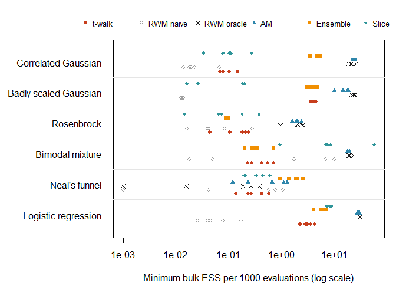
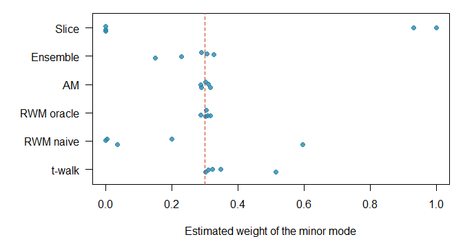
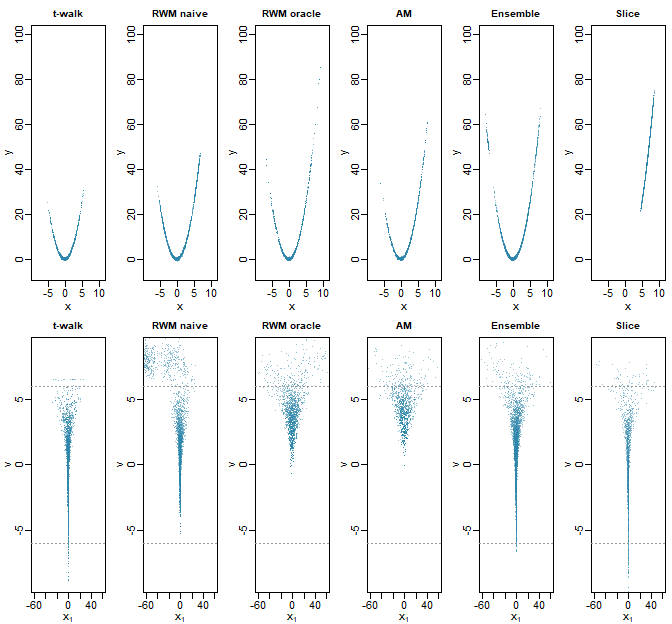
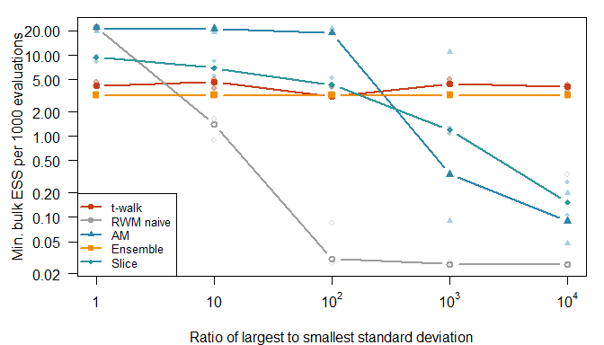

> This vignette is precomputed: running it takes several minutes, so the
> results shown here were generated once with the code it contains (see the
> appendix) and are not recomputed when the package is checked.

## Purpose

The t-walk (Christen & Fox, 2010) is designed to be a *black-box* sampler:
the user supplies a log density and two starting points, and nothing else.
This vignette asks how it compares with other samplers that also require
little or no problem-specific input, on a range of targets with known answers.

The comparison tries to be fair rather than flattering. All samplers get the
same budget of log-density evaluations, start from the same dispersed points,
and are judged by the same diagnostics. We also include a deliberately
*unfair* competitor, random-walk Metropolis tuned with the true covariance of
the target, as an unattainable best case for random-walk methods.
Gradient-based samplers such as Hamiltonian Monte Carlo and NUTS are out of
scope: they require the gradient of the log density, which is exactly what a
black-box sampler does not assume.

## Samplers

| Label | Method | What the user must provide |
|---|---|---|
| `t-walk` | `Rtwalk::twalk()` with the default settings of Christen & Fox (2010) | two starting points |
| `RWM naive` | random-walk Metropolis, proposal $N(0, 2.38^2 I_d / d)$ | a proposal scale (here a generic guess) |
| `RWM oracle` | random-walk Metropolis, proposal $N(0, 2.38^2 \Sigma / d)$ with $\Sigma$ the **true** posterior covariance (Gelman, Roberts & Gilks, 1996) | the answer |
| `AM` | adaptive Metropolis (Haario, Saksman & Tamminen, 2001): starts as `RWM naive`, then uses $2.38^2(\hat\Sigma_t + \varepsilon I)/d$ after $t_0 = 1000$ iterations | adaptation settings |
| `Ensemble` | affine-invariant ensemble sampler with the stretch move, $a = 2$ (Goodman & Weare, 2010), $L = \max(2d, 8)$ walkers | number of walkers, $L$ starting points |
| `Slice` | univariate slice sampling with stepping out and shrinkage, applied coordinate by coordinate (Neal, 2003), $w = 1$, $m = 100$ | an initial width $w$ |

`RWM naive`, `AM`, `Ensemble` and `Slice` are written in plain R and are
listed in the appendix. Two of them share the t-walk's design philosophy:
the ensemble sampler is invariant under affine transformations, and the
slice sampler adapts its step to the local scale.

## Targets

| Target | $d$ | Difficulty |
|---|---|---|
| Correlated Gaussian | 10 | $\Sigma_{ij} = 0.95^{\lvert i-j \rvert}$; condition number $\approx 300$ |
| Badly scaled Gaussian | 10 | independent, standard deviations from $10^{-2}$ to $10^{2}$ |
| Rosenbrock | 2 | the curved "banana" of Christen & Fox (2010, Fig. 3b), $\pi(x, y) \propto \exp\{-\tfrac{1}{20}[100(y - x^2)^2 + (1 - x)^2]\}$ |
| Bimodal mixture | 2 | the two contrasting modes of Christen & Fox (2010, Fig. 3a), weights 0.7 / 0.3 |
| Neal's funnel | 5 | $v \sim N(0, 3^2)$, $x_i \mid v \sim N(0, e^{v})$, $i = 1, \dots, 4$ (Neal, 2003) |
| Logistic regression | 8 | `MASS::Pima.tr` (diabetes, $n = 200$), 7 standardized predictors and an intercept, $N(0, 5^2)$ priors |

All targets have a known answer. For the Rosenbrock density, $x \sim N(1, 10)$
and $y \mid x \sim N(x^2, 0.1)$. For the funnel, $E(v) = 0$ and
$\mathrm{Var}(v) = 9$. For the logistic regression, the reference posterior
moments come from importance sampling with $2 \times 10^5$ draws from a
multivariate-$t_5$ approximation centred at the posterior mode, a method
independent of all the samplers compared.

## Protocol

* Budget: $10^5$ log-density evaluations per run. The t-walk evaluates the
  target once per iteration (except for identity proposals), so it runs
  $10^5$ iterations; the ensemble runs $10^5 / L$ sweeps; the slice sampler
  runs until its budget is spent.
* Five independent replicates per sampler and target. In each replicate all
  samplers start from the same points, drawn from an overdispersed
  approximation of the target (for the mixture, near either mode at random).
* The first 20% of each run is discarded as burn-in.
* Efficiency: the minimum over parameters of the rank-normalized bulk
  effective sample size (Vehtari et al., 2021), per 1000 evaluations. For the
  t-walk, only the primary trajectory `$samples` is used, a conservative
  choice. For the ensemble, the walkers are treated as chains in the
  multi-chain ESS estimator, which averages autocovariances over walkers; this
  is the estimator recommended for ensemble samplers by Goodman & Weare
  (2010) and Foreman-Mackey et al. (2013). Because walkers interact, it can be
  optimistic, which is one reason we also report accuracy.
* Accuracy: the root mean square, over parameters, of the error in the
  posterior mean in units of the posterior standard deviation, and of the
  log-ratio of estimated to true variance.


The full benchmark (180 runs plus a scaling experiment) took
9.5 minutes on a laptop. The importance
sampling reference for the logistic regression had a relative effective
sample size of 66%, so its moments are
accurate to well below the Monte Carlo error of any sampler.

## Results

### Efficiency

The table reports the median, over the five replicates, of the minimum bulk
ESS per 1000 log-density evaluations. Larger is better.


|                      | t-walk| RWM naive| RWM oracle|   AM| Ensemble| Slice|
|:---------------------|------:|---------:|----------:|----:|--------:|-----:|
|Correlated Gaussian   |    0.1|       0.0|       20.4| 23.1|      5.0|   0.1|
|Badly scaled Gaussian |    4.1|       0.0|       22.4| 14.4|      3.9|   0.0|
|Rosenbrock            |    0.2|       0.0|        2.0|  1.9|      0.1|   0.1|
|Bimodal mixture       |    0.4|       1.7|       18.7| 17.6|      0.3|   7.2|
|Neal's funnel         |    0.3|       0.6|        0.2|  0.6|      1.9|   0.3|
|Logistic regression   |    3.0|       0.0|       29.2| 27.4|      6.1|   8.1|


<div class="figure">

<p class="caption">Minimum bulk ESS per 1000 log-density evaluations, one point per replicate (log scale).</p>
</div>

Each point is one replicate; values below $10^{-2}$ indicate a sampler that
essentially did not mix within the budget. Wall-clock time is reported
separately below, because it reflects implementation more than algorithm.

### Accuracy

Efficiency estimates are only meaningful if the chains actually explore the
target. The next two tables report the median RMS error of the posterior
means (in posterior standard deviations) and of the log variances.


|                      | t-walk| RWM naive| RWM oracle|    AM| Ensemble| Slice|
|:---------------------|------:|---------:|----------:|-----:|--------:|-----:|
|Correlated Gaussian   |  0.357|     0.089|      0.019| 0.018|    0.012| 0.198|
|Badly scaled Gaussian |  0.038|     1.152|      0.015| 0.022|    0.034| 0.160|
|Rosenbrock            |  0.221|     0.341|      0.070| 0.064|    1.039| 0.437|
|Bimodal mixture       |  0.041|     0.490|      0.020| 0.019|    0.046| 0.500|
|Neal's funnel         |  0.056|     0.171|      0.299| 0.271|    0.050| 0.083|
|Logistic regression   |  0.049|     0.258|      0.016| 0.016|    0.031| 0.043|


|                      | t-walk| RWM naive| RWM oracle|    AM| Ensemble| Slice|
|:---------------------|------:|---------:|----------:|-----:|--------:|-----:|
|Correlated Gaussian   |  0.743|     0.401|      0.016| 0.014|    0.037| 0.264|
|Badly scaled Gaussian |  0.056|     4.427|      0.016| 0.025|    0.032| 0.102|
|Rosenbrock            |  0.589|     0.712|      0.325| 0.327|    1.597| 1.852|
|Bimodal mixture       |  0.029|     0.368|      0.015| 0.017|    0.027| 0.564|
|Neal's funnel         |  1.608|     1.711|      1.086| 0.677|    0.658| 1.065|
|Logistic regression   |  0.068|     0.606|      0.019| 0.027|    0.037| 0.042|


For the bimodal mixture, the decisive question is whether a sampler moves
between the modes. The figure shows the estimated weight of the minor,
peaked mode (true value 0.3) in each replicate.

<div class="figure">

<p class="caption">Estimated weight of the minor mode of the bimodal mixture in each replicate; the dashed line is the true weight, 0.3.</p>
</div>

### Curved and funnel-shaped targets

Global summaries hide *where* a sampler fails. The draws from the first
replicate of the Rosenbrock and funnel targets show it directly.

<div class="figure">

<p class="caption">Draws from the first replicate on the Rosenbrock (top) and funnel (bottom) targets.</p>
</div>

In the funnel (bottom row, true $v$ ranging over roughly $\pm 6$, dotted
lines), the neck at negative $v$ is very narrow and the mouth at positive
$v$ very wide; no single step size suits both.

### Invariance to scale

Because the t-walk is invariant to changes of scale (Christen & Fox, 2010,
Theorem 1, and approximately so for coordinate-wise rescaling), its
performance should not depend on how badly scaled the target is. We sampled
independent 10-dimensional Gaussians whose standard deviations span
$10^0, 10^1, \dots, 10^4$ (three replicates of $5 \times 10^4$ evaluations).

<div class="figure">

<p class="caption">Minimum bulk ESS per 1000 evaluations as the ratio between the largest and smallest scale of the target grows.</p>
</div>

### Strong correlation

The correlated Gaussian is the t-walk's weakest case in the table above. To
see how this depends on the strength of the correlation, we ran the t-walk on
10-dimensional Gaussians with $\Sigma_{ij} = \rho^{\lvert i-j \rvert}$ (three
replicates of $10^5$ evaluations each), with adaptive Metropolis as a
reference.


Table: Median minimum bulk ESS per 1000 evaluations, 10-dimensional AR(1) Gaussians.

|     |    AM| t-walk|
|:----|-----:|------:|
|0.00 | 23.65|   3.92|
|0.50 | 23.33|   1.66|
|0.80 | 23.87|   0.21|
|0.90 | 23.39|   0.10|
|0.95 | 22.11|   0.10|


The t-walk's efficiency falls by more than an order of magnitude between
$\rho = 0.5$ and $\rho = 0.95$, while adaptive Metropolis, which learns a
global linear transformation, is unaffected. This is the limitation that
Christen & Fox (2010, Section 5) report for highly correlated
high-dimensional posteriors.

### Wall-clock time

The median ESS per second is shown for completeness. It strongly favours the
t-walk, whose kernel is compiled C++, over the competitors written in plain R
for this vignette; it should therefore not be read as a comparison of
algorithms. When the log density is expensive, as in most real applications,
evaluations dominate the cost and the ESS per evaluation above is the relevant
measure.


|                      | t-walk| RWM naive| RWM oracle|  AM| Ensemble| Slice|
|:---------------------|------:|---------:|----------:|---:|--------:|-----:|
|Correlated Gaussian   |     17|         2|       2119| 508|      296|    14|
|Badly scaled Gaussian |   1315|         2|       3465| 374|      280|     9|
|Rosenbrock            |    105|         7|        321|  47|        7|    17|
|Bimodal mixture       |     51|       145|       2109| 473|       18|   906|
|Neal's funnel         |     47|        51|         15|  13|       93|    45|
|Logistic regression   |     64|         1|        561| 277|       92|   168|


## Discussion


The results do not support a single winner, and they do not support the
view that the t-walk is uniformly the most efficient sampler. They do show a
consistent pattern.

**Efficiency per evaluation.** On every target except Neal's funnel,
adaptive Metropolis and the oracle random-walk Metropolis are the most
efficient samplers, often by an order of magnitude or more: on the logistic
regression, for instance, the median minimum ESS per 1000 evaluations is
27.4 for adaptive Metropolis against
3 for the t-walk. With $10^5$
evaluations in at most 10 dimensions, adaptive Metropolis has ample time to
learn the global covariance, after which it behaves like the oracle. The
t-walk is typically in the middle of the group, alongside the ensemble and
slice samplers. It is ahead of naive random-walk Metropolis on four of the six
targets; on the mixture, the naive sampler's larger ESS is misleading (see
below), and on the funnel both are poor. Christen & Fox (2010, Section 4)
found the t-walk within a small factor of optimally tuned random-walk
Metropolis on independent targets; the gap we observe is larger, especially
on the correlated targets.

**Robustness without tuning.** The strongest result for the t-walk is the
scaling experiment: its efficiency is unchanged when the scales of the
coordinates span four orders of magnitude, as predicted by its invariance
(Christen & Fox, 2010, Theorem 1). The affine-invariant ensemble sampler
shares this property. Naive random-walk Metropolis collapses beyond a ratio
of 10, the slice sampler with a fixed width degrades steadily, and adaptive
Metropolis degrades beyond a ratio of $10^2$, presumably because its
initial, non-adapted phase barely moves, so the covariance it learns from is
poor. Adaptation is
powerful when it works, but it needs a reasonable starting proposal; the
t-walk needs nothing.

**Multimodality.** On the bimodal mixture, the samplers with a high
within-mode ESS are not necessarily right. Naive random-walk Metropolis and
the slice sampler often stay in the mode where they start, and their ESS
values describe that mode only. The number of replicates (out of five) whose
estimated weight of the minor mode was within 0.1 of the true 0.3 was
t-walk: 4; RWM naive: 0; RWM oracle: 5; AM: 5; Ensemble: 4; Slice: 0.
The t-walk switches between the modes, through its Hop and Blow moves and
the large Traverse steps between the two points, without any knowledge of
where the modes are.

**Where the t-walk struggles.** Strong correlation in moderate dimension is
the t-walk's main weakness, as the correlation experiment shows and as
Christen & Fox (2010, Section 5) acknowledge. The funnel is difficult for
every sampler: all of them misestimate the variances (median RMS log-variance
error between 0.66 and
1.71), and the t-walk explores the wide mouth
of the funnel less than the ensemble sampler does. For such targets,
reparameterization or gradient-based methods are preferable.

**Cost per second.** The t-walk's compiled kernel makes it the fastest
sampler per unit of time on cheap targets, but, as noted above, this
reflects implementation rather than algorithm.

**In practice.** The t-walk is a sound default for exploratory analysis and
for problems whose scale and correlation structure are unknown or vary across
the space, which is the setting it was designed for. When a posterior is
known to be strongly correlated, or once a first run has revealed its
covariance, a sampler that exploits that information will be more efficient.

**Caveats.** The competitors were implemented compactly and with standard
settings, not optimized. Adaptive Metropolis has variants with better
finite-sample behaviour (e.g. Roberts & Rosenthal, 2009), the ensemble
sampler is often run with more walkers, and the slice sampler's width $w$
could be adapted. Five replicates give a rough picture of the variability,
not precise rankings. The conclusions are about black-box use, which is the
setting the t-walk was designed for.

## References

* Christen, J. A. and Fox, C. (2010). A general purpose sampling algorithm
  for continuous distributions (the t-walk). *Bayesian Analysis*, 5(2),
  263--282. doi:10.1214/10-BA603
* Foreman-Mackey, D., Hogg, D. W., Lang, D. and Goodman, J. (2013). emcee:
  The MCMC hammer. *Publications of the Astronomical Society of the Pacific*,
  125(925), 306--312.
* Gelman, A., Roberts, G. O. and Gilks, W. R. (1996). Efficient Metropolis
  jumping rules. In *Bayesian Statistics 5*, 599--607. Oxford University
  Press.
* Goodman, J. and Weare, J. (2010). Ensemble samplers with affine
  invariance. *Communications in Applied Mathematics and Computational
  Science*, 5(1), 65--80.
* Haario, H., Saksman, E. and Tamminen, J. (2001). An adaptive Metropolis
  algorithm. *Bernoulli*, 7(2), 223--242.
* Neal, R. M. (2003). Slice sampling. *The Annals of Statistics*, 31(3),
  705--767.
* Roberts, G. O. and Rosenthal, J. S. (2009). Examples of adaptive MCMC.
  *Journal of Computational and Graphical Statistics*, 18(2), 349--367.
* Vehtari, A., Gelman, A., Simpson, D., Carpenter, B. and Bürkner, P.-C.
  (2021). Rank-normalization, folding, and localization: An improved
  $\widehat{R}$ for assessing convergence of MCMC. *Bayesian Analysis*,
  16(2), 667--718.

## Appendix: code

The targets:


``` r
make_targets <- function() {
  targets <- list()

  # Correlated Gaussian
  d <- 10
  sigma <- 0.95^abs(outer(1:d, 1:d, "-"))
  prec <- solve(sigma)
  targets$correlated <- list(
    label = "Correlated Gaussian", d = d,
    log_post = function(x) -0.5 * drop(crossprod(x, prec %*% x)),
    mean = rep(0, d), var = rep(1, d), cov = sigma,
    init = function() rnorm(d, 0, 2)
  )

  # Badly scaled Gaussian
  sds <- 10^seq(-2, 2, length.out = d)
  targets$scaled <- list(
    label = "Badly scaled Gaussian", d = d,
    log_post = function(x) -0.5 * sum((x / sds)^2),
    mean = rep(0, d), var = sds^2, cov = diag(sds^2),
    init = function() rnorm(d, 0, 2 * sds)
  )

  # Rosenbrock, k = 1/20: x ~ N(1, 10), y | x ~ N(x^2, 0.1)
  targets$rosenbrock <- list(
    label = "Rosenbrock", d = 2,
    log_post = function(z) -(1 / 20) * (100 * (z[2] - z[1]^2)^2 + (1 - z[1])^2),
    mean = c(1, 11), var = c(10, 240.1),
    cov = matrix(c(10, 20, 20, 240.1), 2),
    init = function() {
      x <- rnorm(1, 1, 2 * sqrt(10))
      c(x, x^2 + rnorm(1, 0, 2 * sqrt(0.1)))
    }
  )

  # Bimodal mixture of Christen & Fox (2010), Fig. 3a
  w <- c(0.7, 0.3)
  mu <- list(c(6, 0), c(-3, 10))
  cov_of <- function(s1, s2, r) matrix(c(s1^2, r * s1 * s2, r * s1 * s2, s2^2), 2)
  covs <- list(cov_of(4, 5, 0.8), cov_of(1, 1, 0.1))
  mix_mean <- w[1] * mu[[1]] + w[2] * mu[[2]]
  mix_cov <- w[1] * (covs[[1]] + tcrossprod(mu[[1]])) +
    w[2] * (covs[[2]] + tcrossprod(mu[[2]])) - tcrossprod(mix_mean)
  precs <- lapply(covs, solve)
  log_consts <- vapply(covs, function(s) -log(2 * pi) - 0.5 * log(det(s)), numeric(1))
  component_logd <- function(x, k) {
    delta <- x - mu[[k]]
    log_consts[k] - 0.5 * sum(delta * (precs[[k]] %*% delta))
  }
  targets$mixture <- list(
    label = "Bimodal mixture", d = 2,
    log_post = function(x) {
      a <- log(w[1]) + component_logd(x, 1)
      b <- log(w[2]) + component_logd(x, 2)
      m <- max(a, b)
      m + log(exp(a - m) + exp(b - m))
    },
    mean = mix_mean, var = diag(mix_cov), cov = mix_cov,
    # Posterior probability of the minor (peaked) mode for each draw
    mode2 = function(draws) {
      a <- log(w[1]) + mvtnorm::dmvnorm(draws, mu[[1]], covs[[1]], log = TRUE)
      b <- log(w[2]) + mvtnorm::dmvnorm(draws, mu[[2]], covs[[2]], log = TRUE)
      mean(b > a)
    },
    init = function() {
      k <- sample(2, 1)
      drop(mvtnorm::rmvnorm(1, mu[[k]], 4 * covs[[k]]))
    }
  )

  # Neal's funnel, v ~ N(0, 9), x_i | v ~ N(0, exp(v))
  targets$funnel <- list(
    label = "Neal's funnel", d = 5,
    log_post = function(z) {
      v <- z[1]
      dnorm(v, 0, 3, log = TRUE) + sum(dnorm(z[-1], 0, exp(v / 2), log = TRUE))
    },
    mean = rep(0, 5), var = c(9, rep(exp(4.5), 4)),
    cov = diag(c(9, rep(exp(4.5), 4))),
    init = function() {
      v <- rnorm(1, 0, 3)
      c(v, rnorm(4, 0, 2 * exp(v / 2)))
    }
  )

  # Bayesian logistic regression, MASS::Pima.tr
  pima <- MASS::Pima.tr
  X <- cbind(1, scale(as.matrix(pima[, 1:7])))
  y <- as.numeric(pima$type == "Yes")
  log_post_logit <- function(beta) {
    eta <- drop(X %*% beta)
    sum(y * eta - pmax(eta, 0) - log1p(exp(-abs(eta)))) +
      sum(dnorm(beta, 0, 5, log = TRUE))
  }
  fit <- optim(rep(0, 8), function(b) -log_post_logit(b), method = "BFGS",
               hessian = TRUE)
  laplace_cov <- solve(fit$hessian)
  set.seed(1)
  proposals <- mvtnorm::rmvt(2e5, sigma = 1.2 * laplace_cov, df = 5,
                             delta = fit$par, type = "shifted")
  log_w <- apply(proposals, 1, log_post_logit) -
    mvtnorm::dmvt(proposals, delta = fit$par, sigma = 1.2 * laplace_cov,
                  df = 5, log = TRUE, type = "shifted")
  weights <- exp(log_w - max(log_w))
  weights <- weights / sum(weights)
  is_mean <- colSums(weights * proposals)
  is_cov <- crossprod(sqrt(weights) * sweep(proposals, 2, is_mean))
  targets$logistic <- list(
    label = "Logistic regression", d = 8,
    log_post = log_post_logit,
    mean = is_mean, var = diag(is_cov), cov = is_cov,
    is_ess_fraction = 1 / sum(weights^2) / length(weights),
    init = function() fit$par + rnorm(8, 0, 3 * sqrt(diag(laplace_cov)))
  )

  targets
}
```

The samplers:


``` r
# Every sampler returns `draws`, an iterations x chains x parameters array,
# and `n_eval`, the number of log-density evaluations used.

run_twalk <- function(log_post, starts, n_eval) {
  fit <- twalk(log_post, n_iter = n_eval, x0 = starts[1, ], xp0 = starts[2, ],
               show_progress = FALSE)
  list(draws = array(fit$samples, c(nrow(fit$samples), 1, ncol(fit$samples))),
       n_eval = fit$n_evaluations + 2)
}

rwm <- function(log_post, x0, n_eval, prop_cov) {
  d <- length(x0)
  R <- chol(prop_cov)
  n <- n_eval - 1
  draws <- matrix(NA_real_, n, d)
  x <- x0
  lp <- log_post(x)
  for (i in seq_len(n)) {
    y <- x + drop(rnorm(d) %*% R)
    lp_y <- log_post(y)
    if (log(runif(1)) < lp_y - lp) {
      x <- y
      lp <- lp_y
    }
    draws[i, ] <- x
  }
  list(draws = array(draws, c(n, 1, d)), n_eval = n_eval)
}

adaptive_metropolis <- function(log_post, x0, n_eval, t0 = 1000, eps = 1e-10) {
  d <- length(x0)
  scale <- 2.38^2 / d
  R <- chol(scale * diag(d))
  n <- n_eval - 1
  draws <- matrix(NA_real_, n, d)
  x <- x0
  lp <- log_post(x)
  running_mean <- x
  running_cov <- matrix(0, d, d)
  for (i in seq_len(n)) {
    y <- x + drop(rnorm(d) %*% R)
    lp_y <- log_post(y)
    if (log(runif(1)) < lp_y - lp) {
      x <- y
      lp <- lp_y
    }
    draws[i, ] <- x
    # Recursive (Welford) update of the empirical mean and covariance
    delta <- x - running_mean
    running_mean <- running_mean + delta / (i + 1)
    running_cov <- running_cov + (tcrossprod(delta, x - running_mean) - running_cov) / (i + 1)
    if (i >= t0) {
      new_R <- tryCatch(chol(scale * (running_cov + eps * diag(d))),
                        error = function(e) NULL)
      if (!is.null(new_R)) R <- new_R
    }
  }
  list(draws = array(draws, c(n, 1, d)), n_eval = n_eval)
}

stretch_ensemble <- function(log_post, starts, n_eval, a = 2) {
  L <- nrow(starts)
  d <- ncol(starts)
  n_sweeps <- (n_eval - L) %/% L
  X <- starts
  lp <- apply(X, 1, log_post)
  draws <- array(NA_real_, c(n_sweeps, L, d))
  for (s in seq_len(n_sweeps)) {
    for (k in seq_len(L)) {
      j <- sample.int(L - 1, 1)
      if (j >= k) j <- j + 1
      z <- ((a - 1) * runif(1) + 1)^2 / a
      y <- X[j, ] + z * (X[k, ] - X[j, ])
      lp_y <- log_post(y)
      if (log(runif(1)) < (d - 1) * log(z) + lp_y - lp[k]) {
        X[k, ] <- y
        lp[k] <- lp_y
      }
    }
    draws[s, , ] <- X
  }
  list(draws = draws, n_eval = L + n_sweeps * L)
}

slice_sampler <- function(log_post, x0, n_eval, w = 1, m = 100) {
  d <- length(x0)
  evals <- 0
  f <- function(x) {
    evals <<- evals + 1
    log_post(x)
  }
  x <- x0
  lp <- f(x)
  draws <- matrix(NA_real_, n_eval, d)
  n <- 0
  while (evals < n_eval) {
    for (j in seq_len(d)) {
      log_level <- lp - rexp(1)
      at <- function(value) {
        z <- x
        z[j] <- value
        f(z)
      }
      left <- x[j] - w * runif(1)
      right <- left + w
      steps_left <- floor(m * runif(1))
      steps_right <- m - 1 - steps_left
      while (steps_left > 0 && at(left) > log_level) {
        left <- left - w
        steps_left <- steps_left - 1
      }
      while (steps_right > 0 && at(right) > log_level) {
        right <- right + w
        steps_right <- steps_right - 1
      }
      repeat {
        candidate <- left + runif(1) * (right - left)
        lp_candidate <- at(candidate)
        if (lp_candidate > log_level) break
        if (candidate < x[j]) left <- candidate else right <- candidate
      }
      x[j] <- candidate
      lp <- lp_candidate
    }
    n <- n + 1
    draws[n, ] <- x
  }
  draws <- draws[seq_len(n), , drop = FALSE]
  list(draws = array(draws, c(n, 1, d)), n_eval = evals)
}
```

The evaluation:


``` r
sampler_labels <- c("t-walk", "RWM naive", "RWM oracle", "AM", "Ensemble", "Slice")

run_sampler <- function(sampler, target, starts, n_eval) {
  d <- target$d
  switch(sampler,
    "t-walk" = run_twalk(target$log_post, starts[1:2, ], n_eval),
    "RWM naive" = rwm(target$log_post, starts[1, ], n_eval, 2.38^2 / d * diag(d)),
    "RWM oracle" = rwm(target$log_post, starts[1, ], n_eval, 2.38^2 / d * target$cov),
    "AM" = adaptive_metropolis(target$log_post, starts[1, ], n_eval),
    "Ensemble" = stretch_ensemble(target$log_post, starts, n_eval),
    "Slice" = slice_sampler(target$log_post, starts[1, ], n_eval)
  )
}

assess <- function(run, target, burnin_frac = 0.2) {
  draws <- run$draws
  n <- dim(draws)[1]
  keep <- seq.int(floor(burnin_frac * n) + 1, n)
  draws <- draws[keep, , , drop = FALSE]
  # A chain that never moves has no defined ESS; count it as zero.
  ess <- vapply(seq_len(target$d), function(j) {
    value <- suppressWarnings(
      posterior::ess_bulk(matrix(draws[, , j], nrow = length(keep)))
    )
    if (is.na(value)) 0 else value
  }, numeric(1))
  pooled <- matrix(draws, ncol = target$d)
  sds <- sqrt(target$var)
  out <- c(
    min_ess = min(ess),
    ess_per_1000 = 1000 * min(ess) / run$n_eval,
    mean_error = sqrt(mean(((colMeans(pooled) - target$mean) / sds)^2)),
    var_error = sqrt(mean(log(apply(pooled, 2, var) / target$var)^2))
  )
  if (!is.null(target$mode2)) out["mode2"] <- target$mode2(pooled)
  out
}

benchmark <- function(targets, n_eval, n_rep, samplers = sampler_labels) {
  results <- list()
  examples <- list()
  for (t in seq_along(targets)) {
    target <- targets[[t]]
    n_walkers <- max(2 * target$d, 8)
    for (r in seq_len(n_rep)) {
      set.seed(1000 * t + r)
      starts <- t(replicate(n_walkers, target$init()))
      if (target$d == 1) starts <- t(starts)
      for (s in seq_along(samplers)) {
        set.seed(100000 * t + 100 * r + s)
        time <- system.time(run <- run_sampler(samplers[s], target, starts, n_eval))
        metrics <- assess(run, target)
        results[[length(results) + 1]] <- data.frame(
          target = target$label, sampler = samplers[s], replicate = r,
          seconds = time[["elapsed"]], n_eval = run$n_eval,
          t(metrics), check.names = FALSE
        )
        if (r == 1 && names(targets)[t] %in% c("rosenbrock", "funnel")) {
          pooled <- matrix(run$draws, ncol = target$d)
          thin <- unique(round(seq(nrow(pooled) * 0.2 + 1, nrow(pooled), length.out = 4000)))
          examples[[names(targets)[t]]][[samplers[s]]] <- pooled[thin, ]
        }
      }
    }
  }
  results <- do.call(rbind, lapply(results, function(x) {
    if (!"mode2" %in% names(x)) x$mode2 <- NA_real_
    x
  }))
  list(results = results, examples = examples)
}
cache_file <- file.path(cache_dir, "sampler_comparison_results.rds")
if (file.exists(cache_file)) {
  cached <- readRDS(cache_file)
} else {
  targets <- make_targets()
  total_time <- system.time({
    main <- benchmark(targets, n_eval = 1e5, n_rep = 5)

    # Scale experiment: independent Gaussians whose standard deviations span
    # 10^k orders of magnitude.
    scale_runs <- list()
    for (k in 0:4) {
      sds <- 10^seq(-k / 2, k / 2, length.out = 10)
      scale_target <- list(scale = list(
        label = sprintf("1e%d", k), d = 10,
        log_post = local({
          s <- sds
          function(x) -0.5 * sum((x / s)^2)
        }),
        mean = rep(0, 10), var = sds^2, cov = diag(sds^2),
        init = local({
          s <- sds
          function() rnorm(10, 0, 2 * s)
        })
      ))
      scale_runs[[k + 1]] <- benchmark(
        scale_target, n_eval = 5e4, n_rep = 3,
        samplers = c("t-walk", "RWM naive", "AM", "Ensemble", "Slice")
      )$results
    }
  })
  cached <- list(
    results = main$results,
    examples = main$examples,
    scale = do.call(rbind, scale_runs),
    is_ess_fraction = targets$logistic$is_ess_fraction,
    total_time = total_time[["elapsed"]],
    session = sessionInfo()
  )
  saveRDS(cached, cache_file)
}

results <- cached$results
target_order <- unique(results$target)
results$target <- factor(results$target, levels = target_order)
results$sampler <- factor(results$sampler, levels = sampler_labels)

med <- function(x) stats::median(x)
summary_table <- function(column, digits) {
  tab <- tapply(results[[column]], list(results$target, results$sampler), med)
  round(tab, digits)
}
correlation_file <- file.path(cache_dir, "sampler_comparison_correlation.rds")
if (file.exists(correlation_file)) {
  correlation <- readRDS(correlation_file)
} else {
  correlation <- do.call(rbind, lapply(c(0, 0.5, 0.8, 0.9, 0.95), function(rho) {
    sigma <- rho^abs(outer(1:10, 1:10, "-"))
    prec <- solve(sigma)
    target <- list(correlation = list(
      label = sprintf("%.2f", rho), d = 10,
      log_post = function(x) -0.5 * drop(crossprod(x, prec %*% x)),
      mean = rep(0, 10), var = rep(1, 10), cov = sigma,
      init = function() rnorm(10, 0, 2)
    ))
    benchmark(target, n_eval = 1e5, n_rep = 3, samplers = c("t-walk", "AM"))$results
  }))
  saveRDS(correlation, correlation_file)
}
correlation_table <- tapply(correlation$ess_per_1000,
                            list(rho = correlation$target, correlation$sampler),
                            stats::median)
knitr::kable(round(correlation_table, 2),
             caption = "Median minimum bulk ESS per 1000 evaluations, 10-dimensional AR(1) Gaussians.")
```
